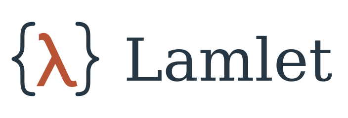

<p align="center">
  
</p>

# Lamlet

> **Note:** This is a vibe-coded project. The design plans, interpreter, standard library, and tests were
> written largely with an AI coding assistant. Review it accordingly before relying on it.

A general-purpose typed functional language designed for rich text with inline computation and control flow.
Its name connects lambda, lexical bindings, and booklets. Static evaluation prepares computed content; a small
runtime supports interactive applications. Host packages define presentation, domain-specific values, and native APIs.

Lamlet can be embedded in a text document: only `$name`, `${...}`, and `$[...]` regions are active. Everything
else is a comment to the language, which a document host can preserve as prose. Typed native stubs let hosts
expose APIs implemented outside Lamlet without changing this source convention.

This repository contains a working Rust interpreter (`crates/lamlet`), documents built to other formats
(`crates/lamlet-doc`, [docs/documents.md](docs/documents.md)), and a CLI (`crates/lamlet-cli`). Tools for one kind
of document are extensions in their own repositories, such as `lamlet-present` for narrated presentations.

## Documentation

- [Introduction to Programming Languages](docs/programming-languages-course.md): a guided theory course using Lamlet, with exercises and an executable companion.
- [Quick start](docs/quick-start.md): the language in ten minutes, for readers who know functional programming.
- [Language specification](docs/spec.md): syntax, core calculus, types, stages, errors, and the `K` boundary.
- [Embedding guide](docs/embedding.md): using Lamlet from a Rust program, with four example hosts.
- [Host interface](docs/host.md): pure descriptions, and the contract every host follows.
- [Design rationale](docs/rationale.md): the decisions behind the language, and the alternatives considered.
- [Implementation notes](docs/implementation.md): modules, status, tests, limits.

```text
$[Import* std]
$[# square {^ {x} {* x x}}]
$[f "The square of 6 is ${square 6}."]
```

The language is a small typed lambda calculus (call by value, exact arity, explicit staging) with structural
records (`{. x 1}`, `.x`, `.x=`), labeled variants (`#tag`, `match`), lists (`{' 1 2}`), recursive lambdas
(`{^ self {n} ...}`), and hygienic pattern macros (`{!if c a b}`). Every primitive in the built-in package `K`
is an ordinary value with an ordinary type, so wrapping or passing a primitive never changes its behavior.

## Building and running

```sh
cargo build --release
./target/release/lamlet examples/hello.lam           # run it: the text, with each region's value filled in
./target/release/lamlet build page.lam -o page.md    # compile to Markdown, HTML, JSON, or speech (docs/documents.md)
./target/release/lamlet eval examples/hello.lam      # JSON results on stdout
./target/release/lamlet prepare examples/hello.lam   # text, prepared values, and residual runtime regions
./target/release/lamlet check examples/hello.lam     # types and stages without running runtime code
cargo test                                           # unit, semantic, fixture, and CLI tests
```

The language and `std` remain application-independent. Host libraries and consumer integration plans belong to
their own projects; this repository uses general contracts and synthetic fixtures.

## Logo

[Primary SVG](assets/lamlet.svg) · [Symbol SVG](assets/lamlet-mark.svg) · [Artwork notes](assets/README.md)
